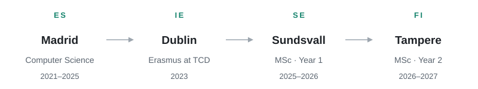

# Hola, I'm Javier!

**Javier Jerez Reinoso**  
Computer Science Engineer  
Erasmus Mundus MSc in Imaging

Interested in Computer Vision, Image Processing & Robotics - building systems that perceive, understand and interact with the world.

---

### My journey so far

<picture>
  <source media="(prefers-color-scheme: dark)" srcset="assets/journey-dark.svg">
  <source media="(prefers-color-scheme: light)" srcset="assets/journey-light.svg">
  
</picture>

---

### Get in touch

- Email: [javjerez.r@gmail.com](mailto:javjerez.r@gmail.com)
- LinkedIn [Javier Jerez Reinoso](www.linkedin.com/in/javier-jerez-reinoso)

